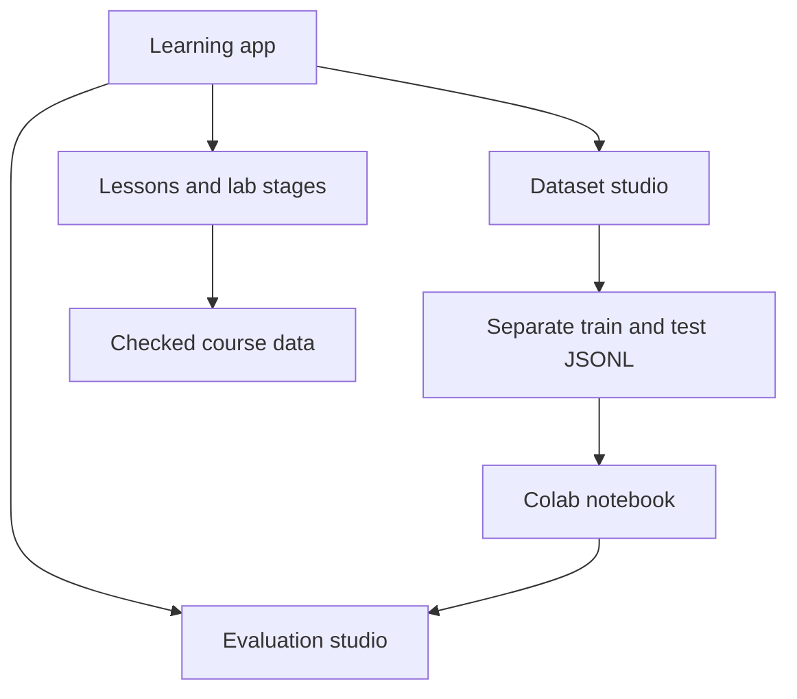

# Architecture and decisions

FineTune Lab is a browser learning application. Training runs separately in a user controlled Colab notebook.

## Boundaries

The Next.js app shell handles navigation and course progress. Each page lives in `components/pages`. Shared presentation primitives live in `components/ui.jsx`. Lessons and notebook stages are data files rather than application logic.

## Decisions

1. **Local browser storage:** no account or database is needed. Progress is private to that browser, but clearing storage loses it and devices do not synchronize. Dataset and evaluation exports provide backups.
2. **Separate evaluation data:** the dataset editor exports one selected split at a time. Browser tests verify that held out examples do not enter the training download.
3. **Notebook as executable training material:** `check-content.mjs` compares all 14 lesson code cells with the bundled notebook. This catches documentation drift; it does not prove a GPU training run succeeds.
4. **Explicit simulations:** memory and loss visuals teach concepts. Their values are not measured model performance or guaranteed GPU requirements.
5. **Page modules:** individual editors and visualizers can be reviewed and changed without editing the entire application.

## Verification boundaries

CI installs from the lockfile, checks formatting and notebook consistency, builds the production site, and runs Chromium tests against that build. GPU training, external model availability and third party notebook compatibility require separate checks. No CI test spends money or sends training examples to a provider.
